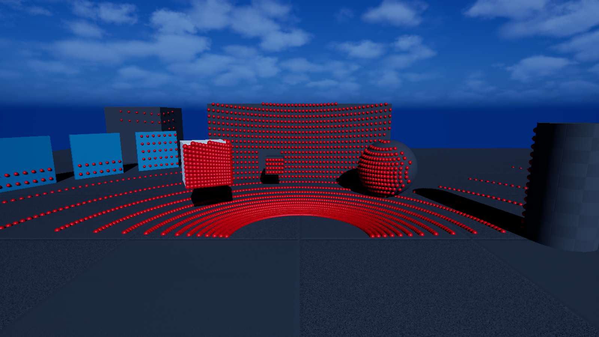

# GEMSTAR UE_Raytracing_Lidar_Feature

[](https://www.dlr.de/en/ts/about-us/the-institute-of-transportation-systems)

The `ue_raytracing_lidar_feature` provides a hardware accelerated ray-tracing LiDAR sensor for GEMSTAR in Unreal Engine.
The feature uses the Unreal Engine’s shared ray tracing scene.
The sensor performs geometric ray casting in the Unreal scene and generates LiDAR reflections as a `SensorView` in OSI.

The feature also supports an optional weather-based degradation of LiDAR performance, using environmental information provided by [ue_weather_effect_feature](https://github.com/DLR-TS/ue_weather_effect_feature#readme) via GEMSTAR `WEATHERDATA` interface.

## Input
- *Optional* Weather Data (Please see the [Configuration](#configuration-for-weather-dependent-lidar-degradation)).

## Output

- OSI Sensor View
- Local GEMSTAR dataflows for logging and visualization

## Getting started

Place the plugin in `Plugins/GameFeatures/ue_raytracing_lidar_feature` and install the GEMSTAR Interfaces plugin. Build the editor and activate the feature through a GEMSTAR experience.

Unreal Engine 5.8, SM6 and a GPU/RHI supporting inline hardware ray tracing are required. The plugin prepares ray tracing and skin-cache support at startup; restart the editor after installing or rebuilding it. The test map has been checked with Windows D3D12 and Linux Vulkan.

## Configuration

Configure sensors in the GEMSTAR scenario INI using sections named `[ue_raytracing_lidar_feature:<sensor name>]`. See [configuration examples](Config/Examples.ini) and the [test-map configuration](Resources/GemstarRtLidarTest.ini).

Supported scan patterns: **Rotating**, **Raster**, **Flash**, **Lissajous** and **Custom**. Each sensor supports mounting, scan rate, range limits, range noise and material profiles. Optional weather degradation uses `WeatherInput` with the weather feature enabled.

`UpdateRateHz` controls both the requested scan rate and the logical scan duration (`1 / UpdateRateHz` seconds, default 10 Hz / 0.1 s). The rate must be finite and at least 1/60 Hz so the duration stays within 60 seconds. At most one scan starts per game frame; dropped scans do not extend the logical duration. Flash rays share the time given by `ScanTimeOrigin`. Pattern-specific parameters are marked in the configuration examples.

The former `ScanFrequencyHz` and `ScanDurationSeconds` INI keys are no longer read. Remove them from existing configurations and set `UpdateRateHz` to the desired scan rate; independently overriding the duration is no longer supported.

Options used by a single scan pattern carry its name as a prefix: `RotatingChannels`, `RotatingVerticalAngles`, `RotatingAzimuthCorrections`, `RotatingStartAzimuthDegrees`; `LissajousRayCount`, `LissajousFrequencyX`, `LissajousFrequencyY`, `LissajousPhaseX`, `LissajousPhaseY`; `CustomRays`, `CustomPatternFile`. Rename the former unprefixed Rotating and Lissajous keys in existing configurations; they are no longer read. Options shared by multiple patterns retain their names.

Connect a sensor to the logger or visualizer through its full section name, for example `ue_raytracing_lidar_feature:Front_Raster`.

### Configuration for weather-dependent LiDAR degradation

The weather model follows SimpleLidar's coefficients and selects one weather condition per scan. Automatic selection prioritizes Fog, then Rain, then Snow. RT signal strength is converted from dB to linear strength for the reflectivity threshold.

Define the weather model according to the [ue_weather_effect_feature](https://github.com/DLR-TS/ue_weather_effect_feature#readme):
 ```ini
[ue_weather_effect_feature]
;Enable or disable behavior/ effect
WeatherEffectEnabled=true
;Explisit weather model: Clear, Fog, Rain, Snow
ActiveWeatherType=Fog
;Meteorological Optical Range in meters for fog condtion
MOR=15.0
;LiDAR weather-model parameters 
LidarCoefficient=1.0
ReflectivityThreshold=10.0
```
In order to use this weather model in the ray-tracing LiDAR sensor use it as an input:
```ini
[ue_raytracing_lidar_feature:Front_Raster]
;...
WeatherInput=[ue_weather_effect_feature]
```

To explicitly disable adverse weather degradation through the selected weather model, set:
 ```ini
;...
WeatherEffectEnabled=false
ActiveWeatherType=Clear
```
For more information about weather-related configuration [ue_weather_effect_feature](https://github.com/DLR-TS/ue_weather_effect_feature#readme)

## Test



Open `/ue_raytracing_lidar_feature/Test/RtLidarTestMap` and press **Play**. The map activates the LiDAR, logger and visualizer features. `Roof_360` scans the surroundings, while `Front_Raster` displays its detected surfaces as red spheres.

The logger records both sensors in `Output/*RT_LIDAR_TEST_MAP.osi` when the simulation stops. Rendering must remain enabled to generate LiDAR points.

---

**Contact:** opensource-ts@dlr.de

This project uses the Open Simulation Interface ([OSI](https://github.com/OpenSimulationInterface/open-simulation-interface)), which is licensed under the Mozilla Public License 2.0.
